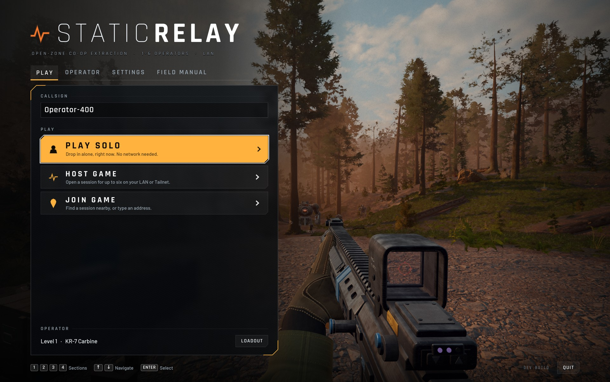
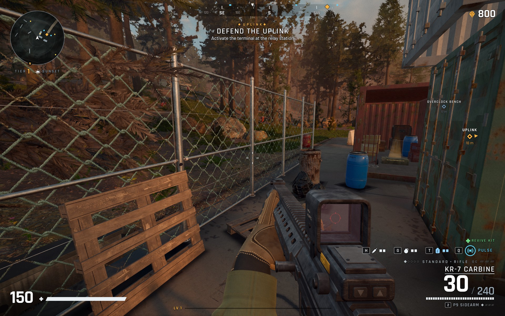
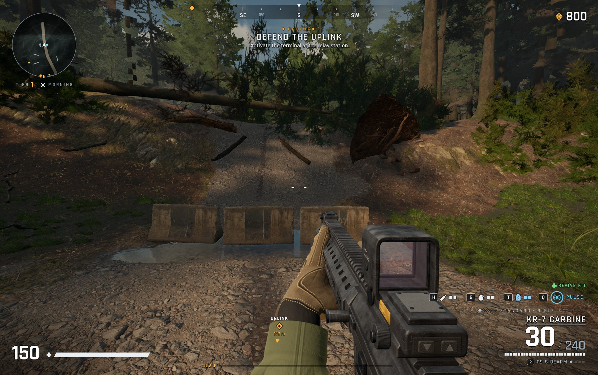
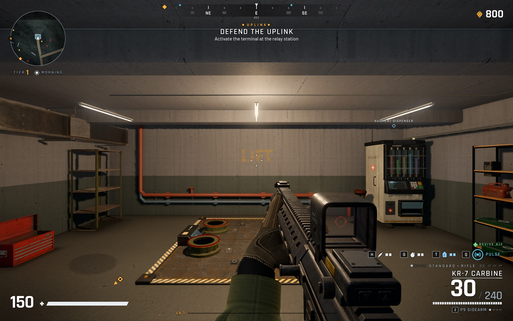

# STATIC RELAY

**A co-op extraction shooter in a forest that has been taken over by machines. One to six operators drop in, do the
job, and decide how far to push before they get out. Free. Mac and Windows.**

Every line of code, every shader, every built model and every synthesised sound in this game was written by an AI
agent, directed and play-tested by one person. The scanned rocks, trees, textures and field recordings come from
public-domain libraries ([credits](CREDITS.md)).

## Download

| | |
|---|---|
| **Mac** (Apple silicon and Intel) | `StaticRelay-mac.dmg` - open it, drag the app to Applications |
| **Windows** (64-bit) | `StaticRelay-win.zip` - unzip, start `Static Relay.exe` |

Both are on the [latest release](../../releases/latest). The Mac app is signed and notarized. The Windows app is not
signed yet: SmartScreen asks once - **More info**, then **Run anyway**. After the first install the game updates
itself from the menu.

## What you do

- **Drop in, alone or with up to five friends.** One of you hosts from the menu; the others join over the local
  network (or over a VPN such as Tailscale). No account, no server to rent.
- **Take an objective, then decide.** Defend the relay while it uploads, walk a rover to the bunker, hunt a Warden,
  carry power cells to the lift, or destroy three spires. Then, at the beacon: push on to the next tier - heavier
  machines, better rewards, the day sliding from morning toward night - or call the exfil and hold the landing zone
  to bank the run.
- **Spend what you earn in the field**: an armory, an overclock bench, an augment dispenser, a supply cache.
- **Thirteen machines**, each with a job and a weak point: Drudges that swarm, Coursers that flank, Lancers that hold a
  line of fire, Wasps overhead, and worse.
- **Seven weapons** you can upgrade in the field with hardware that shows on the gun, an arc charge, a stim, a pulse.
- **Side work** if you want it: a supply drop, a priority target, a rogue transmitter.

## Plays with what you have

- **Mouse and keyboard**, every key rebindable.
- **Controllers**: Xbox, PlayStation, Switch Pro, Steam Deck and generic pads. The game shows the buttons of the pad in
  your hands, every screen works from the pad, and there is gyro aiming if you like it.
- **Sets its own graphics.** It measures the frame rate and picks quality and resolution to hold 60 frames a second
  (or whatever you ask for in Settings → Video).

| | |
|---|---|
|  |  |
|  |  |
|  | |

## What it needs

- **Mac:** macOS on Apple silicon or Intel with Metal. Developed against an M4 Max MacBook Pro.
- **Windows:** Windows 10 or 11, 64-bit, a graphics card with Vulkan (or Direct3D 12). On integrated graphics (a
  handheld) it runs at reduced quality and resolution.
- 2 GB of disk.

## Honest notes

This is a work in progress by a very small team. Known rough edges: the picture is softer than the HUD drawn over it,
some weapons and machines have had less attention than others, and balance has been tuned mostly by bots. On handheld
PCs it runs at reduced quality: about 45-50 frames a second on a ROG Ally X at the settings the game picks for it. If something
breaks or looks wrong, [open an issue](../../issues) - a screenshot and what you were doing is plenty.

**Privacy.** The game talks to this repository to look for updates. It sends nothing else anywhere on its own. If
someone on your own network runs a host that collects session logs (a developer option), the game can send its session
log there; Settings → Session turns that off.

## Licences

The game is free to download and play. Its code is not open source. It is built with the
[Godot Engine](https://godotengine.org) (MIT) and ships fonts under the SIL Open Font License and CC0 sounds, textures
and models: [THIRD-PARTY-NOTICES.txt](THIRD-PARTY-NOTICES.txt), [CREDITS.md](CREDITS.md).
